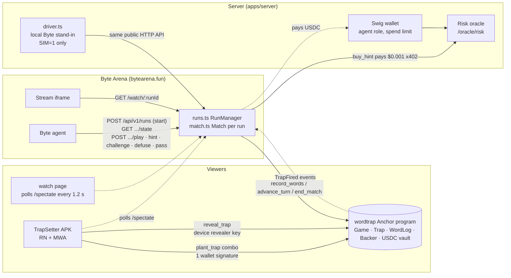

# Architecture (Byte Arena pivot)

**The one-line change:** Byte is no longer our agent. Byte is an external AI streamer run by
bytearena.fun. We publish a turn-based game API; their agent calls it over HTTPS, narrates on
their own stream, and we supply only the game, the on-chain mines, and a spectator page.
Our old in-process agent survives as `driver.ts`, a local stand-in used for sims and rehearsal.



## Platform contract we must satisfy (app.bytearena.fun/api/game-spec)

The spec file is `byte.game.json` at the repo root. The rules that shaped the design:

| Rule | What it forces on us |
|---|---|
| Every response carries the complete game state | `act()` and `/state` both return the full `BoardState`; no deltas |
| Moves come from a closed, enumerable set; no reaction-time dependence | **No wall-clock fuse.** Fuse burns per action. Each action advances the turn by exactly 1 |
| `GET state` has zero side effects | `/state` reads the `Match` without touching turn, fuse, timers or chain |
| Repeated actions must be idempotent or reject stale turns legibly | Optional `turn` in the body; mismatch → 409 `{ error, state }`. Finished runs return final state unchanged |
| Byte cannot invent undeclared params | `play_word.word` must be in `state.hand`; anything else → 400 `{ error, state }` |
| Finished runs must keep answering | Runs stay in memory for the session; no 404 after finish |
| Bets decided from state JSON, not narration | Mines detonate only on words Byte **plays as moves**. We never see narration |
| `watchUrl` must be frameable | `/watch/:id` served as `text/html` with a real `Content-Security-Policy: frame-ancestors 'self' https://app.bytearena.fun` header; polling with plain `setInterval`, never `document.hidden` |
| Limits: 400 calls/run, 12 s/call, 64 KB response, 2 h/run | `turn >= 60` ends the run; reveal hooks must finish inside the request; state kept small (traps are views, events capped at 200) |

## Game rules after the pivot

- Each tile (prompt) comes with a visible **hand of up to 10 word cards**: ~4 obvious answers,
  ~4 sideways synonyms, up to 2 extras. Byte clears a tile by playing `needed` cards one at a time.
- Viewers can see the hand. That is the point: obvious cards are tempting, and mined ones blow up.
- **Fuse** is an integer, starts at 180. End states: `escaped` (all tiles cleared) or `dead`
  (`fuse <= 0` or `turn >= 60`). `score = position * 100 + max(0, fuse)`.

| Action | Fuse cost | Effect |
|---|---|---|
| `play_word` | 5 | Plays one card from `state.hand` onto the current tile. Recorded on-chain as `spoken`. If mined and armed → detonation |
| `buy_hint` | 3 (+ $0.001 USDC via x402) | Scores every hand word for mine risk 0..1. Written into `state.hint` so Byte reads it next call |
| `challenge_word` | 8 | Names a suspected mine **without playing it**. Recorded on-chain as `challenged`. If it was an armed mine, it is permanently disarmed and the card becomes safe to play |
| `defuse_tile` | 20 | Skips the current tile. Max 2 per run (`state.defusesLeft`) |
| `pass_turn` | 10 | Does nothing |
| Detonation | 22 | Setter is paid stake + bounty (capped by the backer pool) |

A mine planted on turn *t* arms on turn *t+1*. Because every action advances the turn by one,
"plant now" means "live on Byte's next action", which is exactly the on-chain rule. A challenge
disarms mines that are armed when it is recorded; one planted on the same turn still arms next
turn (program rule, see `trapFired`).

## On-chain (programs/wordtrap), unchanged

| Account | Seeds | Holds |
|---|---|---|
| `Game` | `match, authority, match_id` | status, turn, totals, bounty budget, reveal deadline |
| vault | `vault, game` | all USDC (backers + mine stakes) |
| `Trap` | `trap, game, commitment` | setter, revealer, stake, armed_turn, status |
| `WordLog` | `word, game, sha256("wordtrap:word"‖word)` | 128-bit bitmap of the turns the word was played + the turn it was first challenged |
| `Backer` | `backer, game, user` | deposit, claimed flag |

**Commitment** = `sha256("wordtrap:v1" ‖ word ‖ salt₃₂ ‖ setter_pubkey)`. The setter's key is part of
the hash, so nobody can copy someone else's commitment and steal the payout. The 32-byte salt
stops anyone from guessing the word by hashing a dictionary.

**When a mine fires:** Byte played the word on some turn `t >= armed_turn`, and if Byte challenged that
word while the mine was active, `t` came before the challenge. One check over a bitmap, O(1).

**Money flow**
- `back_byte`: the deposit goes into the vault and adds to the bounty budget.
- `plant_trap`: the stake goes into the vault.
- `reveal_trap` (allowed live or after the match, until the deadline): pays the setter stake + min(stake × (mult−1), bounty budget).
- `finalize`: once the reveal window closes, takes a snapshot of the vault. Everything left in it goes to backers.
- `claim_backer`: pays out pro-rata. `refund_trap` returns stakes only if nobody backed Byte.

The hash domains (`wordtrap:v1`, `wordtrap:word`), the Rust program, `chain/mock.ts` economics
and the shared hash vectors are frozen. If `packages/shared/test` changes, program compatibility broke.

**Trust assumption (say this to judges):** the referee key records Byte's moves. The referee can't
see what any mine says, so it can't steer Byte away from them. Every recorded word is a public
move Byte sent over HTTP, and the spectator feed shows it.

## Off-chain (apps/server)

| File | Role |
|---|---|
| `runs.ts` | `RunManager`: `start(callsign)` → `{ runId, apiKey, state }`. Holds `Map<runId, { key, match, chain, events }>`, 200 events per run, finished runs kept for the session. SIM mode attaches the crowd to each new run |
| `match.ts` | Turn-based `Match` (EventEmitter). `start()` does `initMatch`, runs `turnHooks` once for pre-start planting, then `startMatch()` → turn 1. `act(name, params)` validates (409 `StaleTurnError`, 400 `InvalidActionError`, state untouched), records words on-chain, **awaits `afterWords` reveal hooks so a detonation lands in the same response**, re-syncs from `chain.snapshot()`, advances the turn, checks end conditions, runs `turnHooks` (sim viewers plant between Byte's calls), returns a copy of the full `BoardState`. Replaces `engine.ts` |
| `content.ts` | Tile deck with `prompt`, `needed`, obvious answers and `sideways` synonyms. `handFor(tile, extras, seed)` deals a deterministic, deduped, mineable hand of ≤ 10 |
| `crowd.ts` | Simulated viewers, attached to every run with `CROWD=1` (and by `SIM=1`), mock chain only. After every turn each setter plants with probability `aggression`; 75% of plants stack onto the 1–2 most obvious cards of the current tile (several mines on one word fire together as a `multi_boom`), the rest scatter onto a random hand card, a word Byte keeps playing, or a word Byte just challenged. A reveal hook detonates its own mines synchronously when played. Backers seed `CROWD_BACKER_USD`. Aggression is the tuning knob, never fuse costs; `scripts/trace.ts` prints survival, detonations per run and zero-boom share |
| `driver.ts` | Pure `decide(state)` → `{ action, word? }`. Buys a hint when ≥ 2 traps are armed, challenges a word scored > 0.85 every 5th turn, defuses when fuse < 35, otherwise plays the lowest-risk card, and every 4th turn deliberately plays the most obvious card so it stays fallible. Replaces `agent.ts` |
| `oracle.ts` | Unchanged. Replies 402 with an `exact` x402 requirement ($0.001 devnet USDC); the server's wallet pays and retries. Scores use public information only |
| `main.ts` | HTTP routes below. SIM=1 plays runs **through its own public API** with `driver.decide`, which doubles as the Byte rehearsal harness |

### HTTP surface

| Route | Auth | Purpose |
|---|---|---|
| `POST /api/v1/runs` `{ callsign }` | none | Start. Returns `{ runId, apiKey, state }`. The only unauthenticated game call |
| `GET /api/v1/runs/:id/state` | Bearer | Full state, zero side effects |
| `POST /api/v1/runs/:id/play` `{ word, turn? }` | Bearer | `play_word` → full state; 400 bad word, 409 stale turn |
| `POST /api/v1/runs/:id/hint` `{}` | Bearer | `buy_hint` |
| `POST /api/v1/runs/:id/challenge` `{ word }` | Bearer | `challenge_word` |
| `POST /api/v1/runs/:id/defuse` `{}` | Bearer | `defuse_tile` |
| `POST /api/v1/runs/:id/pass` `{}` | Bearer | `pass_turn` |
| `GET /runs/:id/spectate?after=seq` | public, CORS `*` | `{ seq, events, state }` for the watch page and mobile app |
| `GET /api/v1/current` | public | `{ runId }` of the most recent live run (second-screen mobile) |
| `GET /watch/:id` | public | Spectator page, `text/html` + `frame-ancestors` CSP header |
| `GET /api/v1/spec` | public | Serves `byte.game.json` |
| `GET /oracle/risk` | x402 | Unchanged |
| `POST /runs/:id/plant`, `/reveal`, `GET /suggest` | mock mode only | Browser demo planter |

### Spectators

- **Watch page** (`apps/watch/index.html`): run id from the path, polls `/spectate` every 1.2 s.
  Shows board, fuse, mines, last played words and action detail, plus a "BYTE'S HAND" row:
  red when a card has detonated, struck through when challenged. No websocket, no audio, no login.
- **Mobile** (`apps/mobile/App.tsx`): polls `/api/v1/current` until a run appears, then `/spectate`
  every 1.5 s. MWA combo arming, secure-store salts and the auto-detonate revealer stay as they were.
  The arming-window countdown is gone; mines arm on the next turn, whenever that is.

### Shared types (`packages/shared`)

`BoardState` carries `status`, `turn`, `position`, `tiles[]` (with `played`), `hand`, `fuse`,
`fuseTotal`, `hint`, `spoken`, `challenged`, `traps`, pool totals, `defusesLeft`, hint spend and
`score`. `FeedEvent` is `state | action | hint | trap_planted | trap_fired | match_end`.
`turn_window` and `narration` are gone. Hashing, tokenize, `trapFired` and money helpers are untouched.

## Fiat staking (Pollar)

Viewers who would never install a wallet sign in with Google through Pollar (or connect an external
Solana wallet) and hold a **ledger balance in integer micro-USD** on our server. The server's
**treasury keypair** is the on-chain setter and backer for all of them, so the Anchor program is
unchanged: a fiat mine is an ordinary `plant_trap` signed by the treasury, and the browser computes
the commitment with the treasury pubkey (`GET /api/v1/treasury`, also `state.treasury`).

**Ledger credits require server-side confirmation; nothing the browser says about money is trusted.**
Sign-in is Pollar's SDK in the browser (`usePollar()`: `login`, `wallet`, `walletBalance`, `sendPayment`,
`txHistory`); the server verifies the SDK access token with the secret key at Pollar Server API v3
`POST /tokens/verify` (header `x-pollar-api-key`), caches it until `expiresAt`, and takes the player's
identity from the Solana wallet address in the verified content. Funding is a USDC transfer the SDK sends
from the player's wallet to the treasury; the server confirms the signature itself on Solana over `RPC_URL`.

```mermaid
sequenceDiagram
  participant V as Viewer browser (apps/stake, @pollar/react)
  participant P as Pollar
  participant S as Game server (fiat.ts)
  participant C as Chain (treasury signs)
  participant B as Byte (HTTP)
  V->>P: Google sign-in creates a Pollar wallet (SDK)
  V->>S: every call carries Authorization: Bearer <SDK access token>
  S->>P: POST /v3/tokens/verify {token} (secret key) → userId, wallet, network, expiresAt (cached)
  V->>P: sendPayment({ chain: SOLANA, destination: treasury, amount, mint: USDC })
  P-->>V: transaction signature (hash)
  V->>S: POST /api/v1/fiat/confirm {signature, amount}
  S->>C: getTransaction(signature) over RPC_URL (finalized, jsonParsed)
  S->>S: sender = verified wallet · destination = treasury's USDC account · mint + amount match · same network
  S->>S: credit ledger exactly once per signature (pending + retry if not finalized; never credited early)
  V->>V: salt + word stay in localStorage; commitment = sha256(v1|word|salt|TREASURY)
  V->>S: POST /runs/:id/plant-fiat {commitmentHex, stake}
  S->>S: debit ledger, record trapId → user
  S->>C: plant_trap (setter = treasury)
  B->>S: POST /runs/:id/play {word}
  S->>C: record_word
  V->>S: POST /runs/:id/reveal-fiat {trapId, word, saltHex}  (spectate feed showed the word was played)
  S->>S: verify commitment server-side
  S->>C: reveal_trap (treasury)
  C-->>S: TrapFired(payout)
  S->>S: credit owner via trapId → user map
  V->>P: cash top-up through a ramp order (GET /v3/ramps/orders/{id}) and off-ramp to bank [ROADMAP]
```

| Invariant | Where |
|---|---|
| I1 treasury is the on-chain setter; browser hashes with the treasury pubkey | `Chain.treasury()`, `/api/v1/treasury`, `state.treasury` |
| I2 word + salt stay in the browser until played; server reveals as treasury; no browser keys | the board's planter (`apps/watch/index.html`), `/runs/:id/reveal-fiat` |
| I3 integer micro-USD everywhere | `fiat.ts` (`MICRO`, `toMicro`) |
| I4 every change persisted: Pollar players' money in Supabase when `SUPABASE_URL` + `SUPABASE_SERVICE_ROLE_KEY` are set (`credit_deposit`, `apply_delta` with kind + stable ref, `players`); guests and demo mode with write-then-rename to `data/fiat-ledger.json`; on start the file is migrated once and stakes of runs that never settled are refunded | `store.ts` (`MoneyStore`), `FiatLedger.save()` |
| I5 credits only after the server confirms the USDC transfer on Solana (finalized, right sender, destination, mint, amount, network); exactly once per signature; not final yet → pending + retry | `confirmUsdcPayment()`, `JsonRpc`, 30 s retry loop |
| I6 viewer identity validated server-side: the SDK access token is verified at `POST /v3/tokens/verify` and the identity is the Solana wallet address; guests (`guest-…`) keep seats and names but can never be funded; mock mode uses plain `{user}` | `PollarServerApi`, `whoIs()` in `main.ts` |

**Pick a side (`/side/:runId`).** Backers fund the pool through `/runs/:id/back-fiat`; trap setters
take a seat and plant through the watch page. The state carries `backingOpen`, `backerCount`,
`bonusesPaid`, `unfiredStake` and `poolNow` (= backerTotal − bonusesPaid + unfiredStake), and
`GET /runs/:id/my-position` returns a signed-in backer's stake, share of the pool and the payout
if the run ended now, computed with `proRata` from `packages/shared`, the same function the
settlement uses. **Known limitation:** backing closes when Byte clears the first tile or at turn 6,
and that cut-off is enforced by the server only. In solana mode the program still accepts
`back_byte` while the match is live; closing it on-chain needs a program change.

Demo-credit mode (no `POLLAR_SECRET_KEY`): the same code path with `MockPollar`; `POST /dev/credit`
registers a fake paid payment and runs it through the verification. It is refused (403) off the mock chain.

**Pollar facts this relies on (docs.pollar.xyz, SDK 0.12 / Server API v3, read Nov 26):** base URL
`https://server.api.pollar.xyz/v3`, secret key in `x-pollar-api-key` (a publishable key is refused with
`API_KEY_TYPE_NOT_ALLOWED`); verify errors `SDK_AUTH_TOKEN_EXPIRED`, `SDK_AUTH_INVALID_TOKEN` (401) and
`SDK_TOKEN_WRONG_APPLICATION` (403) each map to one sentence for the player. There is no payment lookup
endpoint, which is why confirmation is on-chain. Pollar's "testnet" on Solana is **devnet** (the SDK says
so), so test mode pays devnet USDC (`4zMMC9srt5Ri5X14GAgXhaHii3GnPAEERYPJgZJDncDU`); a wallet on another
network than `RPC_URL` is refused (409). The SDK exposes no access-token getter: the browser reads the
session row the SDK persists (`pollar:<apiKeyHash>:session`). Webhooks are not built; everything is pull-based.
Cash top-ups through ramp orders are [ROADMAP].

**Cash-out** (`POST /api/v1/fiat/withdraw { amount, requestId }`, `apps/server/src/withdrawals.ts`): a Pollar
player moves game balance back to the wallet Pollar verified for them, never to a client-supplied address. The
balance drops first (`apply_delta` kind `withdraw`, ref `withdraw:<requestId>`, so a repeat is a no-op), the
treasury (`TREASURY_KEYPAIR`, `apps/server/src/treasury.ts`) signs a `transferChecked` of USDC to the player's
associated token account (created if missing) and the signature is recorded (`withdraw-pending`) before it is
broadcast; finality writes `withdraw-sent`, a definite failure refunds (`refund:withdraw:<requestId>`), and an
unknown outcome stays pending and is re-checked every 30 s and on startup. Before any debit the treasury must hold
the USDC and the SOL for the fee, otherwise "Withdrawals are paused for a moment. Your balance is safe."

## Rooms and seats

One room per run with four seats (`apps/server/src/rooms.ts`). A seat is a server-side record:
taking one returns a seat number and a token, and `plant-fiat` is refused without a valid token for
the caller; backing needs no seat. Bots fill the empty seats, one per seat, and step aside when a
person sits down. A seat with no plant and no authenticated poll for 10 turns is freed and the feed
says so. The first person seated is the host and can make the room private, which hides it from the
lobby and from quick play; anyone else is refused with "Only the host can make the room private."
The room (seats, host, private flag) is never part of the delayed board history: every spectate
response carries it live as a top-level `room`, event snapshots do not carry it, and the watch page
keeps it in its own store, so a replayed snapshot can never put an older seat or room setting back
on screen. **Seats are enforced by the server, not on-chain:** the program only sees
the treasury planting, and it would accept a plant from anyone who signs it.

## Planning ahead and the delayed board

The spectator board runs `SPECTATE_DELAY_SECONDS` behind the game so it keeps pace with Byte's
narration, and a mine only arms the turn after it is planted. So the planter aims at the future:
hands are planned per tile (`Match.planHand`, memoised so the preview is exactly what gets dealt)
and the state carries `nextHand` and `laterHand`. `GET /runs/:id/picker` is an undelayed read that
lists only which cards exist on this, the next and the later tile, never played words, hints or
traps, so it cannot leak a move the board has not shown. Each tile has one safe card (first sideways
card in the hand): reveals on it are refused, so Byte always has an out. Bots plant a third of their
mines on the coming hands. `POST /runs/:id/plant-fiat-batch` arms several cards in one action and
returns the undelayed turn for the "Live from turn N. Byte is on turn M." line.

## Status

The refactor landed on Nov 25: `engine.ts`, `agent.ts`, the websocket feed and the wall-clock fuse
are gone. 17 TypeScript tests cover the hash vectors, the mock chain, the x402 flow, the `Match`
rules and the full HTTP contract. The step-by-step spec that drove it is
`docs/wordtrap-byte-pivot-prompt (1).md`; deployment work is tracked in `docs/HACKATHON_PLAN.md`.
