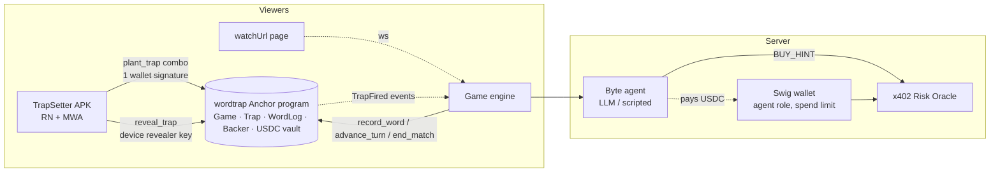

# Architecture

## On-chain (programs/wordtrap)

| Account | Seeds | Holds |
|---|---|---|
| `Game` | `match, authority, match_id` | status, turn, totals, bounty budget, reveal deadline |
| vault | `vault, game` | all USDC (backers + mine stakes) |
| `Trap` | `trap, game, commitment` | setter, revealer, stake, armed_turn, status |
| `WordLog` | `word, game, sha256("wordtrap:word"‖word)` | 128-bit bitmap of the turns the word was said + the turn it was first challenged |
| `Backer` | `backer, game, user` | deposit, claimed flag |

**Commitment** = `sha256("wordtrap:v1" ‖ word ‖ salt₃₂ ‖ setter_pubkey)`. The setter's key is part of
the hash, so nobody can copy someone else's commitment and steal the payout. The 32-byte salt
stops anyone from guessing the word by hashing a dictionary.

**When a mine fires:** Byte said the word on some turn `t ≥ armed_turn`, and if Byte challenged that
word while the mine was active, `t` came before the challenge. One check over a bitmap, O(1). There
is no list of words to search through.

**Money flow**
- `back_byte`: the deposit goes into the vault and adds to the bounty budget.
- `plant_trap`: the stake goes into the vault.
- `reveal_trap` (allowed live or after the match, until the deadline): pays the setter stake + min(stake × (mult−1), bounty budget).
- `finalize`: once the reveal window closes, takes a snapshot of the vault. Everything left in it (deposits minus bounties paid, plus stakes from mines that never fired) goes to backers.
- `claim_backer`: pays out pro-rata. `refund_trap` returns stakes only if nobody backed Byte.

**Trust assumption (say this to judges):** the referee key records Byte's words. The referee can't
see what any mine says, so it can't steer Byte away from them. It could leave a word out of the record, but
every recorded word is a public event you can check against the stream. Stretch goal: have Byte's agent key co-sign each utterance.

## Off-chain

- **Engine** (`apps/server/src/engine.ts`): each turn is mine window → advance turn → Byte acts →
  short grace period for reveals. Byte's thinking time burns real fuse, so viewers watch the clock run.
- **Byte agent** (`agent.ts`): `LlmAgent` returns structured JSON actions. `ScriptedAgent` covers offline demos.
  The narration counts as speech, and that is the core joke of the game.
- **x402 oracle** (`oracle.ts`): replies 402 with an `exact` payment requirement ($0.001 devnet USDC).
  Byte's wallet pays and retries. A facilitator (e.g. PayAI) handles verify and settle.
  Scores come from public information only: how obvious the word is for the prompt, words that already blew up, and how much was staked this window.
- **Feed** (`main.ts`): a WebSocket broadcasts `state / narration / action / hint / trap_planted / trap_fired`.
